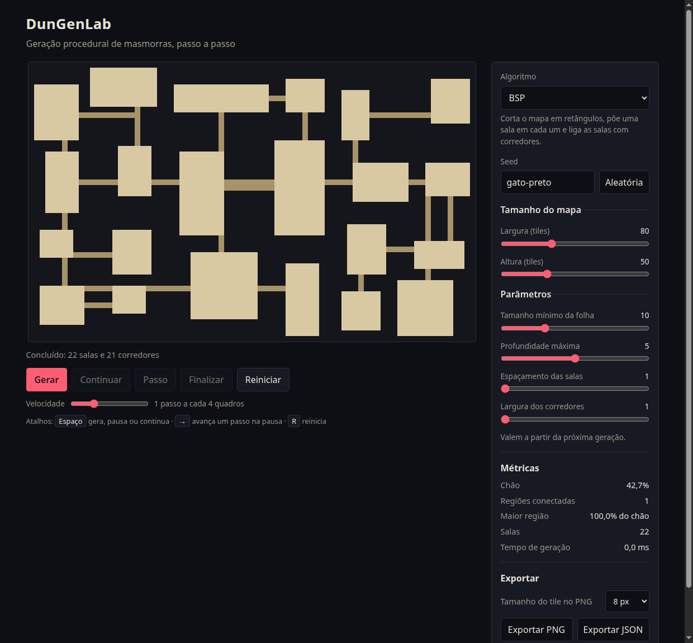
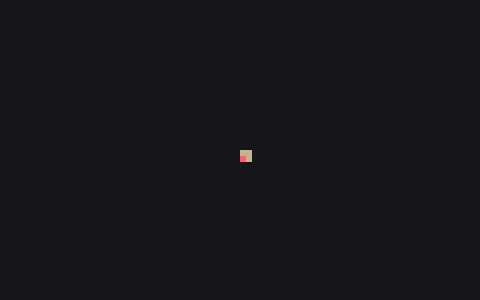
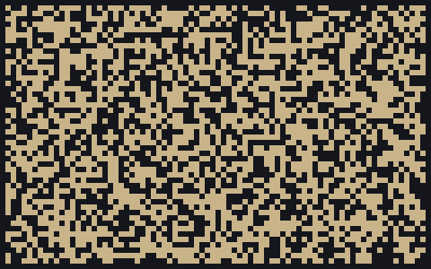

# DunGenLab

Visualizador de geração procedural de masmorras. Escolha um algoritmo, uma
seed e os parâmetros, e veja o mapa ser construído passo a passo em um canvas:
dá para pausar, avançar um passo de cada vez, mudar a velocidade, medir o
resultado e exportar o mapa em PNG ou JSON.

**Demo:** COLOQUE-AQUI-O-LINK-DO-DEPLOY



## O que dá para fazer

- Gerar mapas com três algoritmos: Drunkard's Walk, Cellular Automata e BSP.
- Assistir à geração passo a passo, com play/pause, passo manual, velocidade
  ajustável e um texto dizendo o que o algoritmo está fazendo naquele momento.
- Repetir qualquer mapa: a mesma seed com os mesmos parâmetros gera sempre o
  mesmo resultado, em qualquer navegador.
- Escolher o tamanho do mapa, de 20 × 20 a 200 × 120 tiles.
- Ver as métricas do mapa pronto: porcentagem de chão, regiões conectadas,
  tamanho da maior região, número de salas (BSP) e tempo de geração.
- Exportar em PNG (4, 8 ou 16 pixels por tile) e em JSON, e importar o JSON de
  volta.

Atalhos de teclado: `Espaço` gera, pausa ou continua; `→` avança um passo
quando a animação está pausada; `R` reinicia. Eles não disparam enquanto o
foco está no campo da seed.

## Os algoritmos

### Drunkard's Walk



Um andarilho começa no centro do mapa, que está todo fechado, e a cada
movimento sorteia uma das quatro direções, abrindo chão por onde pisa. Ele
para quando a porcentagem de chão pedida é atingida. Como o caminho nunca se
interrompe, o resultado é sempre uma caverna única e conectada, de contorno
irregular. Os parâmetros controlam quanto chão abrir, quantos andarilhos
trabalham ao mesmo tempo e a tendência de seguir reto em vez de virar, que
troca cavernas arredondadas por túneis compridos.

### Cellular Automata



O mapa começa como ruído: cada tile vira parede ou chão no sorteio. Depois,
por algumas rodadas, cada tile olha para os oito vizinhos e segue uma regra
simples: com muitas paredes em volta vira parede, com poucas vira chão. Em
quatro ou cinco rodadas o ruído se organiza em cavernas de aparência natural.
Cada rodada é calculada em um buffer separado, para que nenhum tile enxergue
um vizinho que já mudou na mesma rodada. Este algoritmo não garante que tudo
fique conectado, e é por isso que a métrica de regiões é interessante aqui.

### BSP (Binary Space Partitioning)


O mapa é cortado em dois retângulos, cada metade é cortada de novo, e assim
por diante, formando uma árvore. Em cada retângulo final (uma folha) entra uma
sala de tamanho sorteado. Na volta, o algoritmo sobe pela árvore ligando as
duas metades de cada corte com um corredor em L. Como toda sala pertence a
alguma metade que foi ligada à outra, o mapa inteiro fica conectado, com cara
de masmorra clássica de salas e corredores.

## Como rodar

Precisa do Node.js 20.19 ou mais novo.

```bash
git clone https://github.com/Hayversong/DunGenLab.git
cd DunGenLab
npm install
npm run dev
```

Outros comandos:

```bash
npm run test     # testes do núcleo (Vitest)
npm run lint     # ESLint
npm run build    # checagem de tipos + build de produção em dist/
npm run preview  # serve o build de produção localmente
npm run format   # Prettier
```

## Decisões técnicas

**Algoritmos como generators.** Cada algoritmo é uma `function*` que altera o
grid e faz `yield` a cada passo lógico. Foi a decisão que mais simplificou o
projeto: a mesma função serve para animar (consumo alguns passos por quadro),
para pausar (paro de consumir), para o passo manual (consumo um) e para gerar
tudo de uma vez (consumo até o fim). Não existe uma versão "animada" e outra
"instantânea" de cada algoritmo para manter em sincronia.

**PRNG com seed.** Nada no núcleo usa `Math.random`. Os algoritmos recebem um
gerador de números pseudoaleatórios (mulberry32), alimentado por um hash do
texto da seed (xmur3). É isso que torna os mapas reproduzíveis, e também o que
permite testar os algoritmos: um teste pode afirmar que a mesma seed produz
exatamente o mesmo grid.

**Núcleo sem React.** Tudo em `src/core` é TypeScript puro: não importa React
e não toca no DOM. Os algoritmos, as métricas e a importação/exportação rodam
nos testes sem navegador, e poderiam ser levados para outro projeto sem
alteração. O React cuida só dos controles; quem conversa com o núcleo é um
único hook, `useGeneration`.

**Grid em `Uint8Array`.** O mapa é um array de bytes de tamanho
`largura × altura`, em que o tile `(x, y)` fica em `y * largura + x`. É
compacto, rápido de percorrer e barato de copiar. O grid vive em uma `ref`, e
não no estado do React: os algoritmos o alteram no lugar e um contador de
versão avisa o canvas de que é hora de redesenhar. Colocar o grid inteiro no
estado a cada quadro deixaria a animação lenta.

**Flood fill iterativo.** As regiões conectadas são contadas com uma busca em
largura usando fila. A versão recursiva é mais curta, mas estoura a pilha em
mapas grandes com uma região comprida.

**Arquivo JSON validado.** A importação não confia no arquivo: confere versão,
tipos, dimensões e o conteúdo dos tiles, e mostra uma mensagem na tela em vez
de quebrar. Os parâmetros também são presos aos limites de cada algoritmo
antes de qualquer geração.

## Estrutura de pastas

```
src/
├─ core/                    # TypeScript puro, sem React e sem DOM
│  ├─ types.ts              # Grid, Tile, GenStep, MapGenerator...
│  ├─ constants.ts          # tamanho padrão e limites do mapa
│  ├─ grid.ts               # criar, ler e escrever no grid
│  ├─ rng.ts                # PRNG com seed (mulberry32 + xmur3)
│  ├─ params.ts             # prende parâmetros nos limites do algoritmo
│  ├─ metrics.ts            # % de chão, regiões (flood fill), salas
│  ├─ export.ts             # toJSON / fromJSON com validação
│  └─ generators/           # drunkardsWalk, cellularAutomata, bsp e o registro
├─ render/
│  ├─ canvasRenderer.ts     # desenha o grid no canvas
│  ├─ pngExport.ts          # gera o PNG em um canvas fora da tela
│  └─ download.ts           # dispara o download de um arquivo
├─ hooks/
│  ├─ useGeneration.ts      # controla a animação: play, pause, passo, velocidade
│  └─ useKeyboardShortcuts.ts
├─ components/              # MapCanvas, PlaybackBar, ControlPanel, ParamField,
│                           # MetricsPanel, ExportPanel
├─ App.tsx
└─ main.tsx
tests/                      # testes do núcleo e do renderer (Vitest)
media/                      # imagens deste README
```

Para acrescentar um algoritmo, basta criar um arquivo em
`src/core/generators/` que siga a interface `MapGenerator` e incluí-lo no
registro: o seletor, os controles de parâmetros e a animação aparecem sozinhos
na interface.

## Stack

Vite, React, TypeScript em modo `strict`, Canvas 2D, Vitest, ESLint e Prettier.
Sem bibliotecas de interface e sem dependências de runtime além do React.
